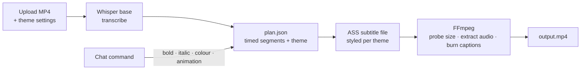

<div align="center">

# 🎬 AI Video Studio

**Upload a raw clip and get it back with styled captions burned in, perfectly timed and ready for Reels and Shorts.**

[](https://nextjs.org/)
[](https://fastapi.tiangolo.com/)
[](https://github.com/openai/whisper)
[](https://ffmpeg.org/)
[](https://tailwindcss.com/)

[Why](#why) · [How it works](#how-it-works) · [Caption themes](#caption-themes) · [Run locally](#run-locally)

</div>

---

## Why

Most short-form video is watched on mute, so captions decide whether someone keeps watching.
Captioning by hand means transcribing, timing every line and styling it in an editor, which takes about an hour for a one-minute clip.
AI Video Studio does it in one upload.

## Features

- 🎤 **Speech to text on your machine.** OpenAI Whisper transcribes the clip locally with segment timestamps, so no audio is sent to a paid API.
- ⏱️ **Captions timed to the speech.** Each line appears and disappears with the words.
- 🎨 **Themes.** Default, Bold, Cinematic or Minimal set the font size, colour, outline and shadow for you.
- ✨ **Caption animation and video mode** options in the side panel.
- 💬 **Chat to restyle.** Type "make it bold", "italic", "yellow" or "remove animation" and the edit plan updates.
- 🔊 **Original audio kept.** The audio track is extracted and merged back into the captioned video.
- 📐 **Captions fit any frame.** The video size is probed first, so captions scale correctly for 9:16, 16:9 or 1:1.
- ⬇️ **One-click download** of the rendered MP4.

## How it works



1. `POST /process` saves the upload and runs Whisper to produce timed segments.
2. The selected theme is written into the **edit plan** (`plan.json`), the single source of truth for every render.
3. `caption_renderer` turns the plan into an **ASS subtitle file**, a format that supports rich styling, outlines and positioning.
4. FFmpeg probes the video size, burns the captions in and keeps the original audio.
5. `GET /output-video` streams the result with no-cache headers, so you always get the newest render.

## Caption themes

| Theme | Look |
|---|---|
| `default` | White, 28 pt, 2 px black outline |
| `bold` | Yellow, 34 pt, 3 px outline + shadow, for high-energy clips |
| `cinematic` | White, 26 pt, thin dark outline + soft shadow |
| `minimal` | Light grey, 24 pt, no outline, unobtrusive |

Add a theme by adding an entry to `THEMES` in `backend/renderer/theme_filters.py`.

## Tech stack

| Layer | Technology |
|---|---|
| Frontend | Next.js (App Router), React, TypeScript, Tailwind CSS, Lucide icons |
| Backend | Python, FastAPI, python-multipart |
| Speech | OpenAI Whisper (`base` model, runs locally on PyTorch CPU) |
| Rendering | FFmpeg, ffprobe, ASS subtitles |

## Run locally

**Prerequisites:** Python 3.10+, Node.js 18+, and FFmpeg on your `PATH`.

```bash
git clone https://github.com/kartikeyajay2006/AI-Video-Editor.git
cd AI-Video-Editor

# Backend: http://localhost:8000
cd backend
pip install -r requirements.txt     # installs Whisper + CPU PyTorch
uvicorn app:app --reload --port 8000
```

```bash
# Frontend: http://localhost:3000 (new terminal)
cd frontend
npm install
npm run dev
```

## Project structure

```text
backend/
  app.py                 /process and /output-video
  renderer/              whisper_transcribe, caption_renderer (ASS), theme_filters, render_video (FFmpeg)
  pipeline/              audio extraction, segmentation, keyword highlights, edit-plan builder
  editor/                chat commands applied to the edit plan
  storage/               optional S3 upload client
frontend/
  app/page.tsx           upload → options → preview → download
  components/            UploadBox, OptionsPanel, VideoPreview, CaptionOverlay, ChatBox
```

## Roadmap

- Word-by-word karaoke highlighting from the keyword pipeline
- Automatic silence trimming and jump cuts
- A job queue so several videos can render at once

## Author

Built by **[Kartikeya Yadav](https://github.com/kartikeyajay2006)**.
[LinkedIn](https://www.linkedin.com/in/kartikeya2006/) · [Portfolio](https://kartikeya-portfolio-rx7w.vercel.app/)
